<!--
GABRIEL MELLO — ENGINEERING UNIVERSE
Authorial vector design. No third-party stats cards, trackers, iframes, or JS.
Compatible with the GitHub profile repo GabrielMello1407/GabrielMello1407.
-->

  <picture><source media="(max-width: 600px)" srcset="hero-mobile.svg" /></picture>
  

    <a href="https://gabriel-mello.com/">Portfolio</a>&nbsp; · &nbsp;
    <a href="https://github.com/GabrielMello1407?tab=repositories">Open source</a>&nbsp; · &nbsp;
    <a href="https://www.linkedin.com/in/gabrielmellomoraes/">LinkedIn</a>&nbsp; · &nbsp;
    <a href="mailto:gabrielmellomoraes1407@gmail.com">Get in touch</a>
  

  
<strong>Software Engineer</strong> · Full Stack · Applied AI · Product Architecture

<a href="https://gabriel-mello.com/"><picture><source media="(max-width: 600px)" srcset="terminal-mobile.svg" /></picture></a>

I build software where **architecture, product thinking and applied AI** have to work together in production. From multi-tenant SaaS platforms and real-world LLM orchestration to reliable public-sector systems, I design, implement, ship and maintain complete solutions.

<!-- Identity begins with engineering, rather than a conventional badge wall. -->

### 01 · My engineering topology

<picture><source media="(max-width: 600px)" srcset="stack-mobile.svg" /></picture>

### 02 · The Engineering Core

<picture><source media="(max-width: 600px)" srcset="core-mobile.svg" /></picture>

> **My approach:** understand the problem → design the system → connect the layers → ship, measure and improve. AI is a capability built into reliable engineering, not a replacement for it.

### 03 · Selected work

**01 / FlunexApp — SaaS · Founder & Lead Engineer**

<a href="https://www.flunexapp.com/"><picture><source media="(max-width: 600px)" srcset="project-01-mobile.svg" /></picture></a>

A production SaaS for WhatsApp automation with visual flow creation, multi-provider LLM capabilities, dedicated workers, Redis/BullMQ, and strict tenant isolation. [Explore FlunexApp ↗](https://www.flunexapp.com/)

**02 / Rotamer — Open Source · Molecular Engineering**

<a href="https://github.com/GabrielMello1407/Rotamer"><picture><source media="(max-width: 600px)" srcset="project-02-mobile.svg" /></picture></a>

An open-source molecular learning environment with a custom 2D editor, RDKit validation, three-dimensional geometry and an optional AI tutor. **The deterministic engine verifies; AI explains.** [Source code ↗](https://github.com/GabrielMello1407/Rotamer) · [Project site ↗](https://rotamer.vercel.app/)

**03 / Gerador de ETP — Institutional AI · GovTech**

<a href="https://geradoretpdigital.uenp.edu.br/"><picture><source media="(max-width: 600px)" srcset="project-03-mobile.svg" /></picture></a>

A production system for preliminary technical studies at UENP, combining Gemini, retrieval-augmented generation and institutional document production. [View platform ↗](https://geradoretpdigital.uenp.edu.br/)

**04 / AITEC — Institutional Platform · Full Stack**

<a href="https://aitec.uenp.edu.br/"><picture><source media="(max-width: 600px)" srcset="project-04-mobile.svg" /></picture></a>

A modern institutional portal and admin experience built with Next.js, React, PostgreSQL, Prisma and Redis, replacing a legacy CMS. [View platform ↗](https://aitec.uenp.edu.br/)

### 04 · Signals from GitHub

<picture><source media="(max-width: 600px)" srcset="dashboard-mobile.svg" /></picture>

<picture><source media="(max-width: 600px)" srcset="activity-mobile.svg" /></picture>

Live public data from the official GitHub REST/GraphQL APIs, refreshed via GitHub Actions. Contribution totals can differ from a signed-in profile if private activity is hidden. Language bars count repositories by primary language, not lines of code. Until the first successful workflow run, values are explicitly unavailable.

### 05 · Beyond the code

- **At UENP:** Institutional software, AI features, integrations and systems that support real operational workflows.
- **In product engineering:** Multi-tenancy, authentication, billing, asynchronous workers, APIs and reliability.
- **In applied AI:** RAG, multi-provider LLM workflows, validation, guardrails and responsible integration.

  <a href="https://gabriel-mello.com/"><picture><source media="(max-width: 600px)" srcset="footer-mobile.svg" /></picture></a>
  
<a href="https://gabriel-mello.com/">gabriel-mello.com</a> · <a href="https://www.linkedin.com/in/gabrielmellomoraes/">LinkedIn</a> · <a href="mailto:gabrielmellomoraes1407@gmail.com">Email</a>

