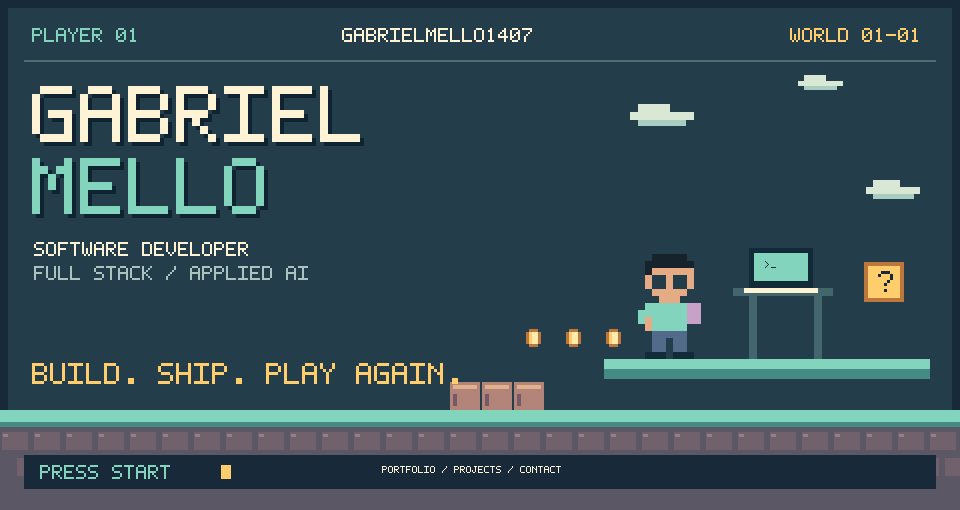
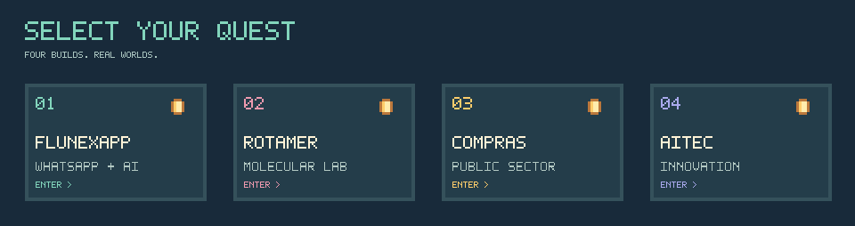

  <a href="https://gabriel-mello.com"><b>START / PORTFOLIO</b></a> &nbsp; · &nbsp;
  <a href="https://www.linkedin.com/in/gabrielmellomoraes/">LINKEDIN</a> &nbsp; · &nbsp;
  <a href="mailto:gabrielmellomoraes1407@gmail.com">CONTACT</a>

I'm Gabriel, a software developer at **UENP** and the creator of **FlunexApp**. I work with full-stack applications, automation and applied AI. Based in Brazil.

**Inventory:** TypeScript · React · Next.js · Python · Node.js · PostgreSQL · Redis · Docker

Daily sync from GitHub. Commits and best streak cover the last 12 months; streaks count days with contributions, including PRs and issues. Public data only. Today can remain open until midnight; a streak continues when yesterday was active.

| Quest | What I built | Play |
| :--- | :--- | :--- |
| **01 · FlunexApp** | WhatsApp automation, visual flows, AI and worker infrastructure. | [Open project →](https://www.flunexapp.com/) |
| **02 · Rotamer** | A molecular editor with 2D/3D structures and an AI tutor. | [Source code →](https://github.com/GabrielMello1407/Rotamer) |
| **03 · Compras Públicas** | AI-assisted procurement documents for UENP. | [Open platform →](https://compraspublicas.uenp.edu.br/) |
| **04 · AITEC** | Institutional portal, content management and transparency. | [Open platform →](https://aitec.uenp.edu.br/) |

Original SVG pixel art · No JavaScript in the profile · Animation respects reduced-motion settings

